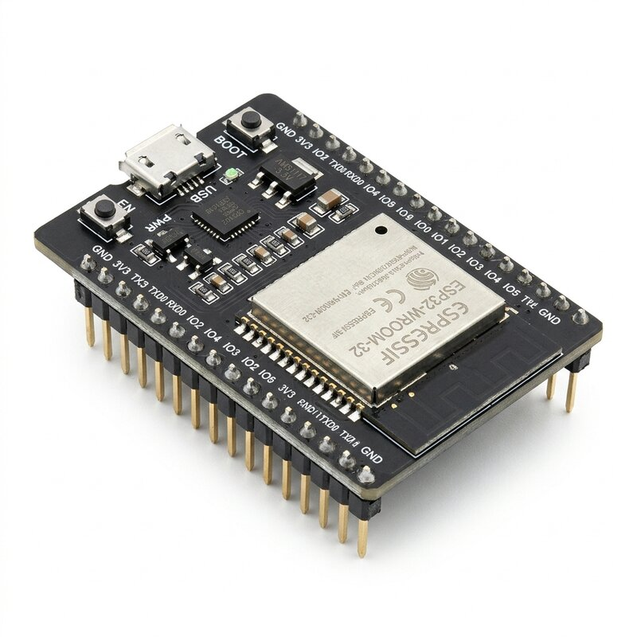
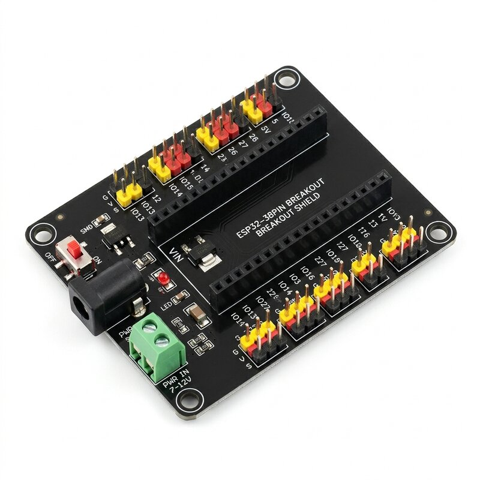
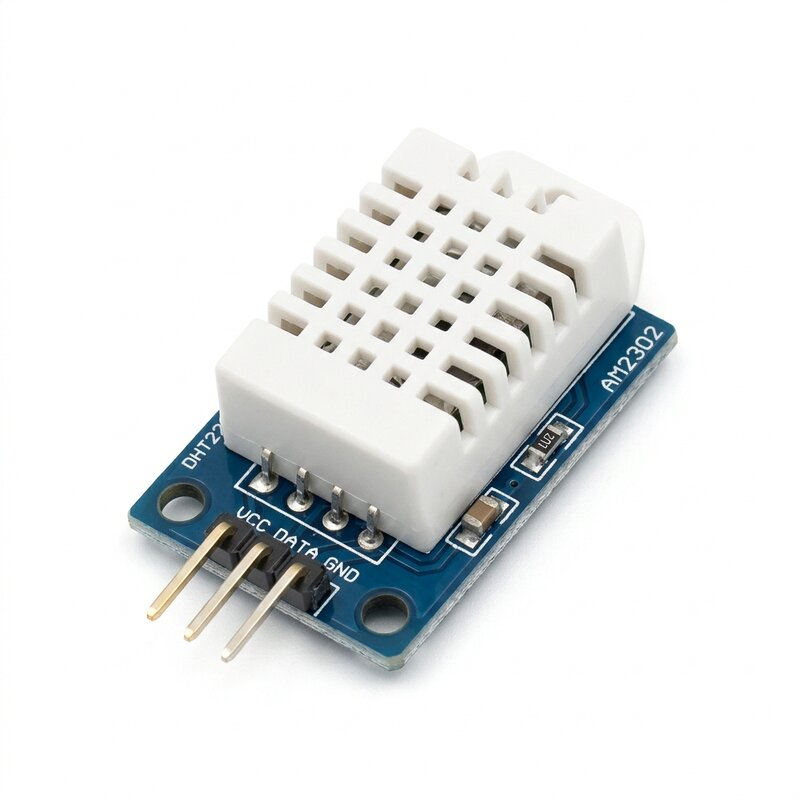
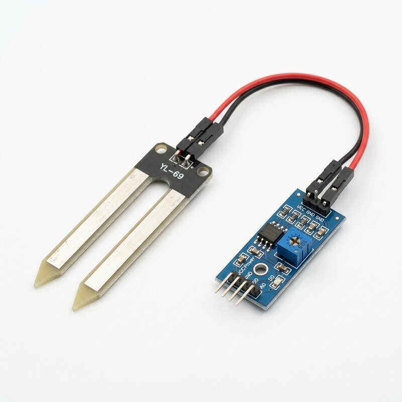
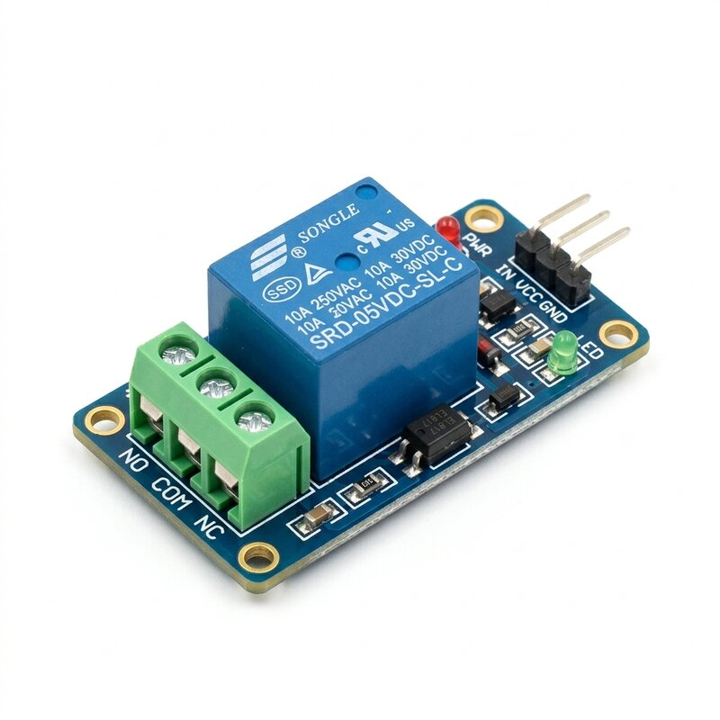
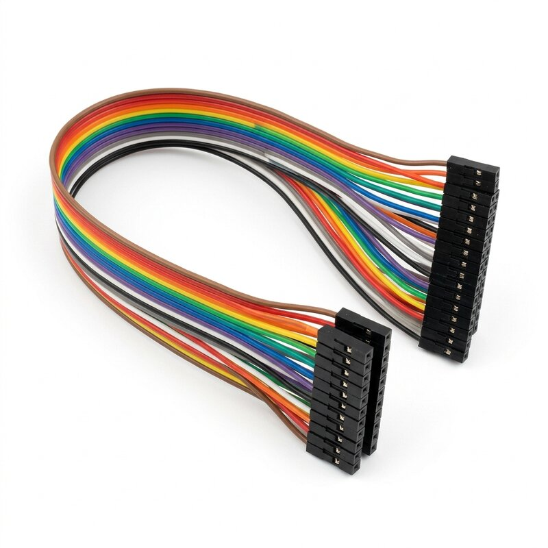

# 🌿⚙️ TREM — Guias de Montagem e Prompts de IA

> **O Trem que monitora e controla qualquer ambiente — na internet e no celular.**  
> 🌐 **Site oficial:** [trem.app.br](https://trem.app.br) · 📸 **Instagram:** [@trem.app.br](https://www.instagram.com/trem.app.br) · ✉️ **Contato:** contato@trem.app.br

Bem-vindo! Se você chegou aqui pelo site ou pelo Instagram e **nunca usou o GitHub antes**, não se preocupe: você **não precisa saber programar**.

Esta página reúne tudo o que você precisa para **comprar as peças certas** (no AliExpress, Mercado Livre ou loja local) e **montar seu próprio sistema de automação TREM sem solda**.

---

## 🚀 Comece Aqui em 3 Passos Simples

### Passo 1 — Escolha suas peças (com ajuda gratuita da IA)

Não sabe quais peças comprar para a sua estufa, horta, casa ou comércio?  
👉 **[Clique aqui para abrir o Prompt Montador de Kit (AliExpress)](prompts/montar-kit-sob-demanda.md)** — basta copiar o texto e colar no ChatGPT, Claude ou Gemini gratuitos. A IA vai conversar com você e montar sua lista de compras!

Prefere uma lista pronta para começar hoje?  
👉 **[Veja a Lista de Compras do Kit Básico (Clima + Solo + 1 Relé)](guias/kit-basico.md)**  
👉 **[Veja o Catálogo Completo de Sensores e Kits por Aplicação](guias/catalogo-pecas-e-kits.md)**

---

### Passo 2 — Conheça cada peça do seu Kit (sem caixa-preta)

| Peça | Nome | Para que serve |
|:---:|---|---|
|  | **1. Placa ESP32 (38 Pinos)** | O **cérebro** com Wi-Fi e Bluetooth que lê os sensores e executa suas automações (mesmo se a internet cair). |
|  | **2. Shield de Expansão 38P** | A **base sem solda** onde você encaixa o ESP32 para organizar os pinos de energia (`3V3`, `5V`, `GND`) e sinal. |
|  | **3. Sensor DHT22** | Mede **temperatura e umidade do ar** em tempo real. |
|  | **4. Sensor de Solo LM393** | Mede a **umidade da terra** dentro do vaso ou canteiro (`0 a 100%`). |
|  | **5. Módulo Relé 5V** | O **interruptor inteligente** que liga e desliga bombas d'água, umidificadores, exaustores e lâmpadas. |
|  | **6. Cabos Jumpers Fêmea-Fêmea** | Os cabinhos coloridos de encaixe rápido que conectam tudo sem precisar de ferro de solda. |

👉 **[Ler explicação detalhada de todas as peças (`guias/pecas-e-componentes.md`)](guias/pecas-e-componentes.md)**

---

### Passo 3 — Monte na bancada pino a pino com segurança

Já está com as peças em mãos? Siga nosso mapa visual de fios antes de ligar na tomada:  
👉 **[Abrir o Guia de Montagem Passo a Passo (`guias/montagem-passo-a-passo.md`)](guias/montagem-passo-a-passo.md)**

---

## 🤖 Todos os Prompts de IA da TREM

| Prompt | O que ele faz por você | Status |
|---|---|---|
| **[Montador de Kit sob Demanda (AliExpress)](prompts/montar-kit-sob-demanda.md)** | Entende seu projeto e gera a tabela de compras com termos exatos de busca do AliExpress e mapa de pinos | ✅ **Disponível** |
| **[Guia de Montagem de Sensor](prompts/guia-montagem-sensor.md)** | Confere fotos da sua montagem antes de ligar na tomada | 🚧 Em construção |
| **[Criador de Regra de Automação](prompts/regra-automacao.md)** | Ajuda a planejar limites e histerese das suas automações | 🚧 Em construção |
| **[Diagnóstico de Leitura](prompts/diagnostico-leitura.md)** | Ajuda a identificar mau contato ou ruído em sensores | 🚧 Em construção |

---

## 📄 Licença

Conteúdo licenciado sob [Creative Commons Attribution 4.0 International (CC BY 4.0)](https://creativecommons.org/licenses/by/4.0/) — você pode usar e adaptar citando a **TREM — Controle e Automação** (<https://trem.app.br>). Texto completo em [`LICENSE`](LICENSE). As marcas, logotipos e o nome **TREM** não estão cobertos por esta licença.
