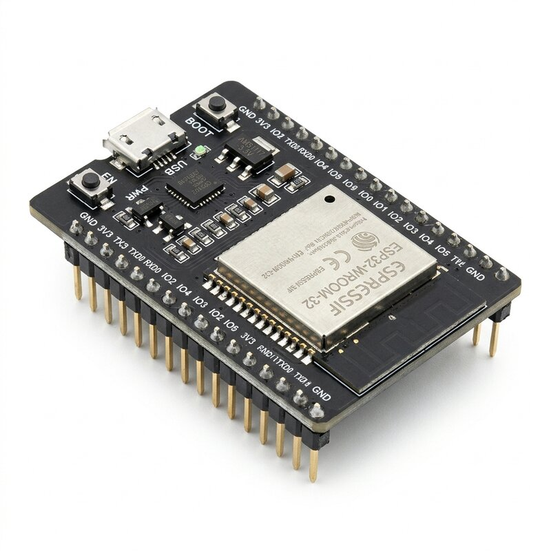
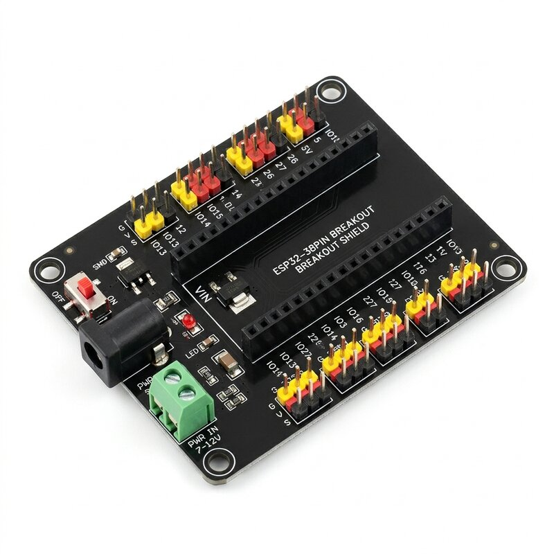
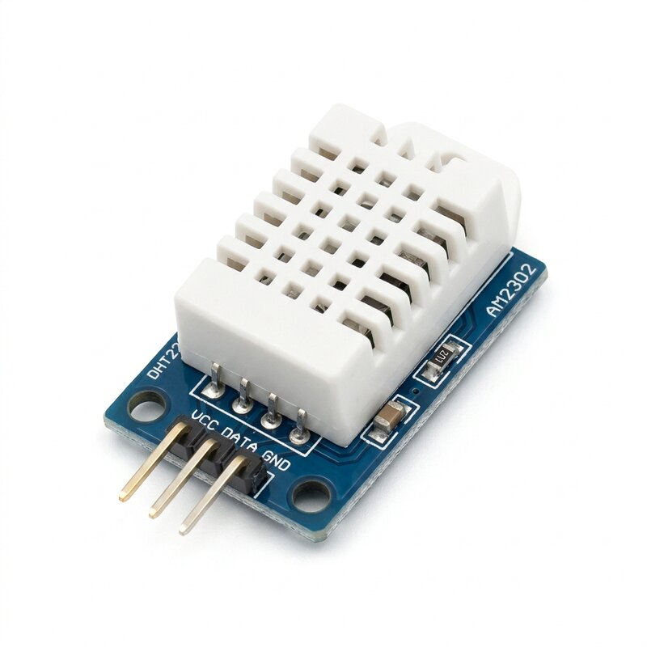
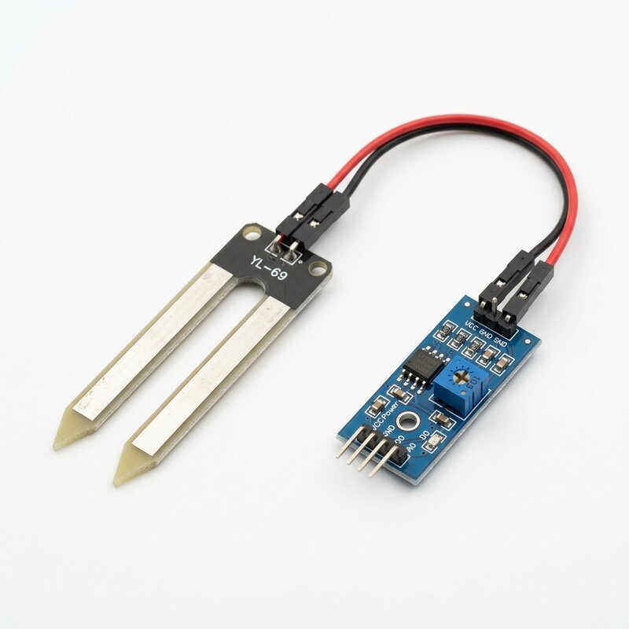
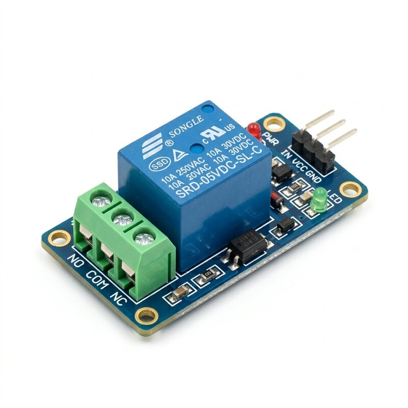
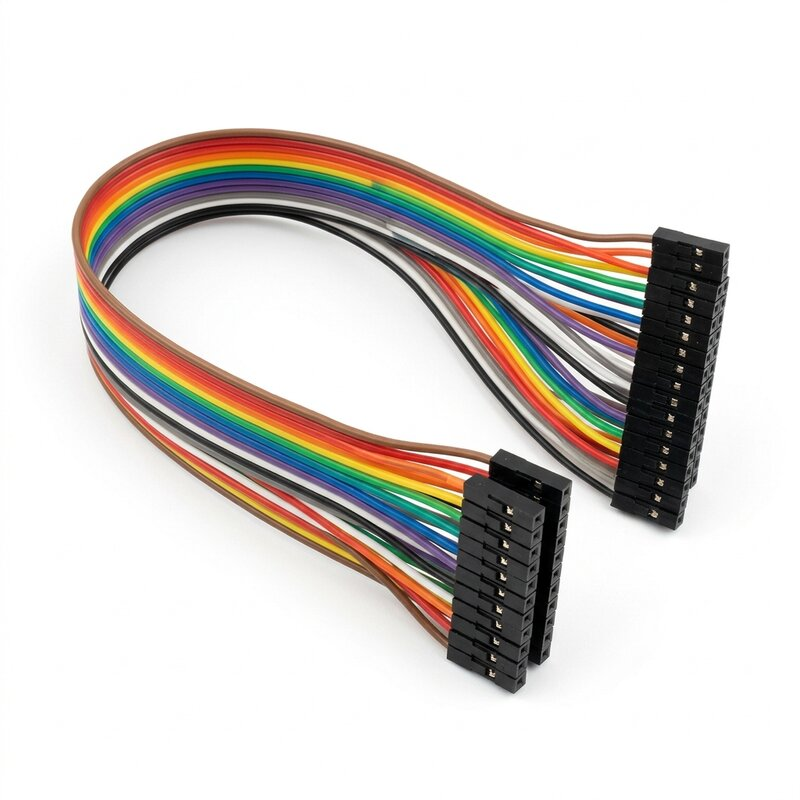

# Kit Básico — Lista de Peças (DIY)

Este é o conjunto mínimo recomendado para montar seu primeiro nó TREM com **leitura de clima (ar), leitura de umidade do solo e 1 acionamento automático via relé**.

Você pode comprar as peças na loja de eletrônica ou marketplace de sua preferência.

| Qtd | Peça | Item | Especificação importante na compra |
|----:|------|------|------------------------------------|
| 1 |  | **Placa ESP32-WROOM-32** | Versão padrão de **38 pinos** (estreita), conector USB-C ou Micro-USB |
| 1 |  | **Placa de Expansão (Shield) ESP32 38P** | Compatível com ESP32 de **38 pinos** (confira a largura antes de comprar) |
| 1 |  | **Sensor DHT22 (AM2302)** | Preferir o módulo em plaquinha com **3 pinos** (`+`, `OUT/DATA`, `-`), que já traz o resistor *pull-up* embutido |
| 1 |  | **Sensor de Umidade do Solo LM393** | Módulo com placa comparadora (4 pinos: `VCC`, `GND`, `DO`, `AO`) + sonda + cabos |
| 1 |  | **Módulo Relé 1 Canal 5V (`SRD-05VDC-SL-C`)** | Com optoacoplador (ou módulo de 2/4 canais caso queira acionar mais cargas) |
| 1 |  | **Kit de Jumpers Fêmea-Fêmea** | Pelo menos 15 fios (10 cm ou 20 cm) |
| 1 | — | **Fonte de Alimentação + Cabo USB** | Cabo USB de dados (para gravar o firmware) + fonte 5 V / 2 A (ou fonte 9 V DC no conector P4 do shield) |

## Opcional (para automação prática logo de início)
- **1x Umidificador ultrassônico 5 V** (ou mini bomba d'água 5 V/12 V com sua respectiva fonte).
- **Case plástico** ventilado ou impresso em 3D para proteger a placa contra poeira e respingos.
