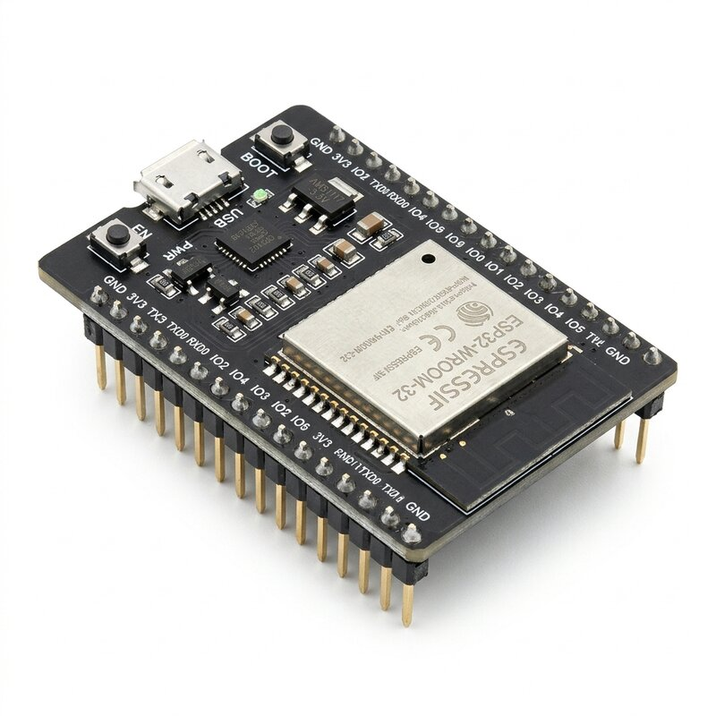
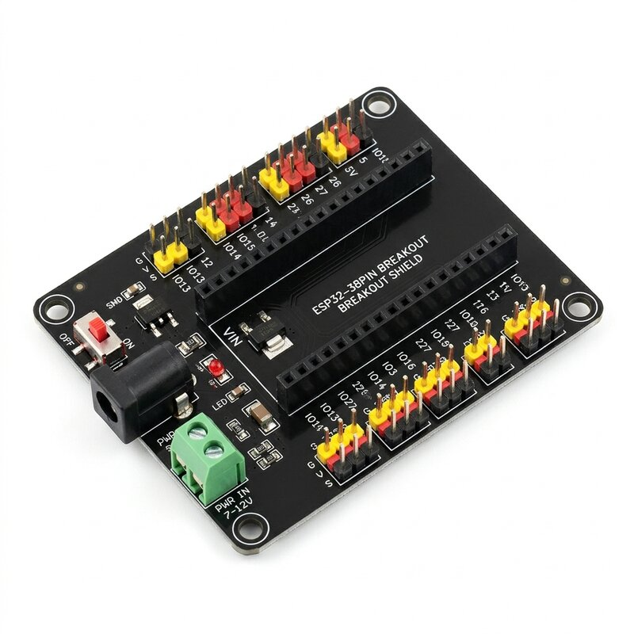
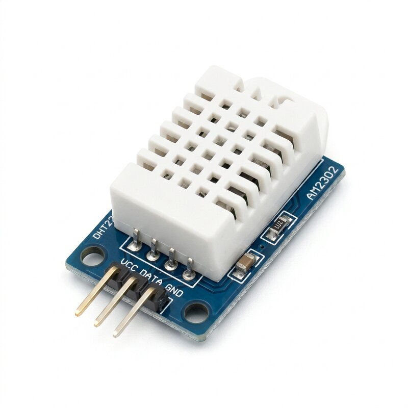
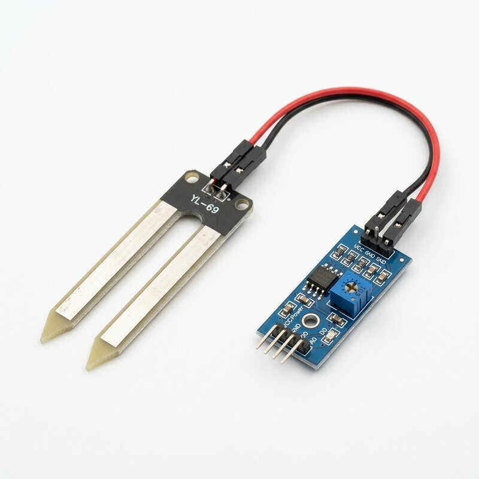
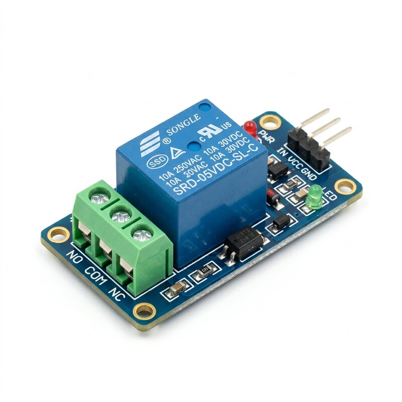
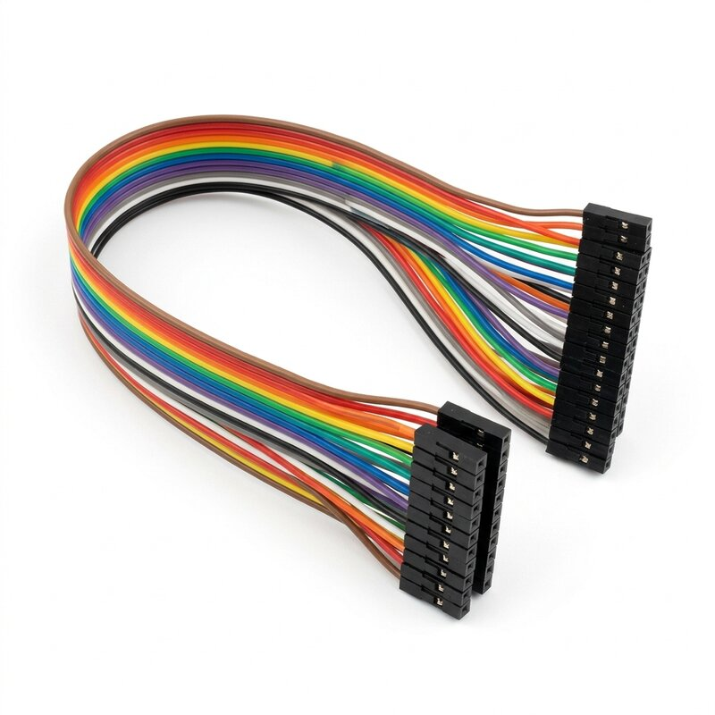

# Peças e Componentes Compatíveis

Conheça os principais blocos de hardware usados nos projetos com a TREM.

---

## 1. Controladores (O "Cérebro")

### ESP32-WROOM-32 (38 pinos)

Microcontrolador com **Wi-Fi e Bluetooth** integrados. Ele lê os sensores, executa as regras de automação localmente (mesmo se a internet cair) e envia os dados para o aplicativo.
- **Tensão lógica dos pinos:** `3,3 V` (nunca aplicar `5 V` direto nos pinos de sinal/ADC).
- **Interfaces:** GPIO digital, ADC (leitura analógica de 12 bits), I2C, SPI, UART e PWM.

### Placa de Expansão (Shield) para ESP32 38 Pinos

Placa base onde o ESP32 é encaixado. Ela transforma os pinos apertados da placa em **barras de pinos organizadas** com trilhas de `3V3`, `5V` e `GND` dedicadas, além de entrada de alimentação externa via conector P4 (DC Jack, `6,5 V – 16 V`) ou USB.
- **Por que usar:** evita solda, reduz mau contato e facilita ligar vários sensores ao mesmo tempo usando jumpers simples.

---

## 2. Sensores (Os "Sentidos")

### DHT22 (AM2302) — Temperatura e Umidade do Ar

Sensor digital de alta confiabilidade para clima ambiente (estufas, quartos, adegas, depósitos).
- **Alimentação:** `3,3 V – 5 V` (`5 V` recomendado para maior estabilidade).
- **Faixa de medição:** `-40 °C a +80 °C` (`±0,5 °C`) e `0–100% UR` (`±2–5%`).
- **Interface:** 1 pino de dados digital (`1-Wire`).

### LM393 — Umidade do Solo

Módulo composto por uma sonda de forquilha (2 hastes que vão no substrato/solo) ligada a uma plaquinha comparadora com 4 pinos (`VCC`, `GND`, `DO`, `AO`).
- **Alimentação recomendada:** **`3V3` estrito** (para que a saída analógica `AO` nunca ultrapasse `3,3 V` e proteja o ESP32).
- **Leitura:** usa o pino **`AO`** (saída analógica) ligado a uma entrada `ADC1` do ESP32. O pino `DO` fica desconectado.

> **Outros sensores compatíveis para expansão futura:** `DS18B20` (temperatura à prova d'água / câmara fria), `BH1750` (luminosidade em lux), `PIR HC-SR501` (presença), `MQ-2` (gás/fumaça) e sonda de solo `RS485`.

---

## 3. Atuadores (Quem "Age")

### Módulo Relé 1 ou 4 Canais (`SRD-05VDC-SL-C`)

Interruptor eletrônico controlado pelo ESP32. Permite ligar e desligar cargas externas (lâmpadas, bombas d'água, exaustores, umidificadores, válvulas) isolando eletricamente a carga do microcontrolador via optoacoplador.
- **Alimentação da bobina:** **`5 V`** (no pino `VCC` / `DC+`).
- **Sinal de controle (`IN`):** `3,3 V` vindo de um GPIO de saída do ESP32.
- **Contatos de carga:** `COM` (comum), `NO` (normalmente aberto — liga quando acionado) e `NC` (normalmente fechado).

### Exemplos de Cargas Acionadas via Relé
- **Umidificador Ultrassônico 5V (USB):** alimentado por carregador USB `5 V / 2 A`, com o fio positivo `+5 V` interrompido nos bornes `COM` e `NO` do relé *(nunca ligue umidificador 5 V em fonte 12 V)*.
- **Bomba d'água / Ventilador / Iluminação:** ligados em série pelo relé ou contatora compatível com a potência da carga.

---

## 4. Cabos e Conexões

### Jumpers Fêmea-Fêmea (Dupont)

Cabos flexíveis com conectores fêmea nas duas pontas para ligar os pinos machos do shield aos sensores e ao módulo relé sem precisar soldar. Recomenda-se usar cores diferentes (ex.: vermelho para `5V`/`3V3`, preto/marrom para `GND`, outras cores para sinal) para evitar inversões.
